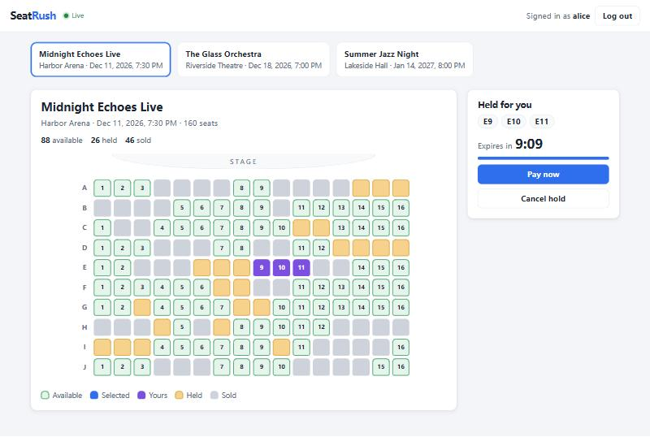
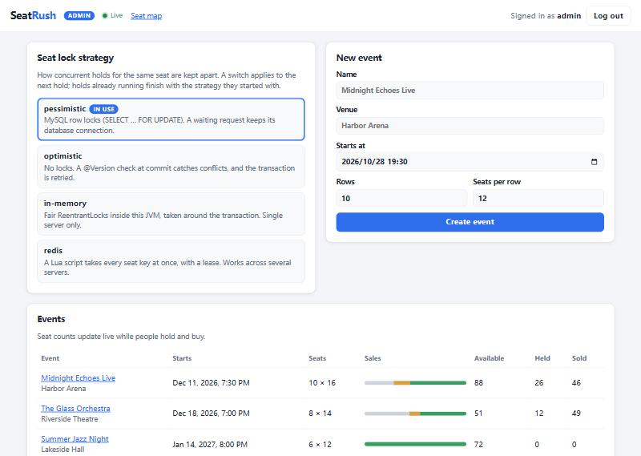
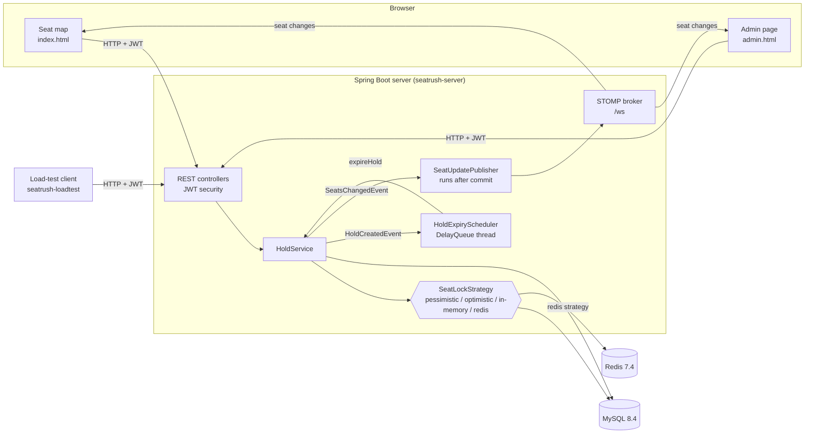
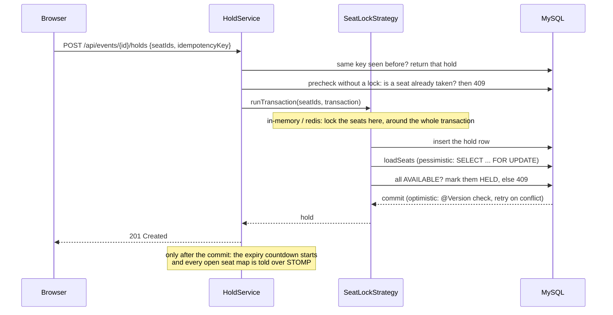

# SeatRush

**A ticketing back end for the moment sales open:** hundreds of people click on the same seats in
the same second, and no seat may ever be sold twice.

SeatRush is a Spring Boot application that does the following:

- **Holds seats.** A user can hold up to 4 seats for a few minutes, then pay or cancel. Holds that
  run out are released automatically.
- **Pushes every change live** to the seat map in the browser over WebSocket/STOMP.
- **Keeps concurrent requests apart with four interchangeable lock strategies:**
  - pessimistic (`SELECT … FOR UPDATE`)
  - optimistic (`@Version`)
  - in-memory (`ReentrantLock`)
  - distributed (Redis + Lua)

  An admin can switch strategies while the application is running.
- **Comes with a load-test client** that fires a rush of hundreds of simultaneous requests and
  checks that nothing was double-booked.

Built as the final project for CS6103 Intro to Java (Fall 2026).





## Contents

- [Architecture](#architecture)
- [How a hold works](#how-a-hold-works)
- [The four lock strategies](#the-four-lock-strategies)
- [Advanced Java concepts used](#advanced-java-concepts-used)
- [Getting started](#getting-started)
- [API](#api)
- [Configuration](#configuration)
- [Tests](#tests)
- [Load test](#load-test)
- [Project layout](#project-layout)
- [Limitations and next steps](#limitations-and-next-steps)

## Architecture



There are two Maven modules:

- **`seatrush-server`**: the Spring Boot 4.1 application on Java 21, with the two web pages under
  `src/main/resources/static`.
- **`seatrush-loadtest`**: a plain Java client with no Spring. It uses only `java.net.http` and
  Jackson.

MySQL stores everything; the schema is managed by Flyway. Redis is only used by the Redis lock
strategy.

## How a hold works



- **States.** A seat goes `AVAILABLE → HELD → SOLD`, or back to `AVAILABLE` when the hold is
  cancelled or expires. A hold goes `ACTIVE → CONFIRMED | CANCELLED | EXPIRED`.
- **Idempotency.** The client sends a key with each hold request, and the table has a unique
  `(user_id, idempotency_key)`. A retried request therefore gets the original hold back instead
  of a second one, even when both copies arrive at the same moment.
- **Deadlock-free lock order.** Locks are always taken in the same order: first the hold, then the
  seats in ascending id order. Confirm, cancel and expiry lock the hold row first, so the three of
  them can never mix states.
- **Expiry.** Every active hold sits in a `DelayQueue`, and one background thread releases holds
  as their deadlines pass. On restart the queue is refilled from the database. Expiry takes the
  same hold lock as confirm, so a payment and an expiry racing each other cannot both win.
- **Push after commit.** Seat changes are published inside the transaction but sent by a
  `@TransactionalEventListener`, so a browser never sees a change that was rolled back. Clients may
  only subscribe to seat topics; a client `SEND` is rejected, so nobody can broadcast fake
  updates.

## The four lock strategies

All four implement one interface with two hooks. `runTransaction` wraps the whole transaction,
including the commit. `loadSeats` reads the seats inside the transaction.

```java
public interface SeatLockStrategy {
    String name();
    default <T> T runTransaction(SortedSet<Long> seatIds, Supplier<T> transaction) { return transaction.get(); }
    List<Seat> loadSeats(SortedSet<Long> seatIds);
}
```

| Strategy | How it keeps two requests apart | Waits? | Works with several servers? |
|---|---|---|---|
| `pessimistic` (default) | MySQL row locks: `SELECT … FOR UPDATE` in `loadSeats` | in MySQL, holding a connection | yes |
| `optimistic` | no lock; `@Version` on `Seat` rejects the second write at commit, then one retry | never | yes |
| `in-memory` | 1024 striped, fair `ReentrantLock`s with a timed `tryLock`, around the transaction | in the JVM | **no** |
| `redis` | a Lua script takes every seat key at once (all or nothing), with an owner token and a lease | polls Redis | yes |

An external lock (in-memory, Redis) **must cover the commit**. A mutation test showed that
releasing it one step earlier lets the next request read stale data. The `@Version` column stays
on `Seat` as a last line of defence. It is what makes switching strategies at runtime safe, as
`StrategySwitchTest` shows: a request that loses that way gets a 409, not a double booking.

## Advanced Java concepts used

| Concept | Where |
|---|---|
| Threads and executors: `ExecutorService`, virtual threads, `CountDownLatch` start gate, `Future` | `loadtest/Rush.java`, `loadtest/Users.java`, `HoldConcurrencyTest` |
| Explicit locks: fair `ReentrantLock`, timed `tryLock`, lock striping, lock ordering | `lock/InMemorySeatLockStrategy.java` |
| Concurrent utilities: `DelayQueue` + `Delayed`, `AtomicReference`, `AtomicInteger`, `CopyOnWriteArrayList` | `hold/HoldExpiryScheduler.java`, `hold/ExpiringHold.java`, `lock/SeatLockStrategies.java` |
| Interfaces with default and generic methods, functional interfaces, lambdas: the Strategy pattern | `lock/SeatLockStrategy.java` and its four implementations |
| Modern Java: records, enums with abstract methods, switch expressions, text blocks, pattern matching for `instanceof`, `SequencedCollection.reversed()` | DTOs, `loadtest/Scenario.java`, `live/ListenOnlyInterceptor.java`, `lock/RedisSeatLockStrategy.java` |
| Transactions and database locking: JPA, `PESSIMISTIC_WRITE`, `@Version`, `TransactionTemplate`, events after commit | `hold/HoldService.java`, `event/SeatRepository.java`, `event/Seat.java` |
| Networking: `java.net.http.HttpClient`, WebSocket with STOMP | `loadtest/SeatRushClient.java`, `live/` |
| Security: JWT (HS256), BCrypt with an HMAC pepper, role-based access | `auth/`, `config/SecurityConfig.java` |
| Testing: concurrent race tests, `@ParameterizedClass`, mutation testing, a fake HTTP server from the JDK | `src/test/java` in both modules |

## Getting started

You need **JDK 21** and **Docker Desktop**; the Maven wrapper is included. The commands below are
for Windows PowerShell. On macOS or Linux use `./mvnw` instead of `.\mvnw.cmd`.

```powershell
docker compose up -d                                  # MySQL on 3306, Redis on 6379
.\mvnw.cmd -pl seatrush-server spring-boot:run        # http://localhost:8080
```

- **Seat map**: <http://localhost:8080/>. Create an account in the top bar, pick seats, hold them,
  then pay or cancel. Open a second browser window as another user to watch the changes arrive
  live.
- **Admin page**: <http://localhost:8080/admin.html>. Log in as `admin` / `admin12345`, the
  local development defaults. You can switch the lock strategy, create events and watch sales.
- **For a demo**: run `$env:SEATRUSH_HOLDS_DURATION = "60s"` before starting the server, so that
  holds expire after one minute instead of five.

## API

Errors are RFC 9457 `ProblemDetail` JSON. A conflict is a 409; when seats were already taken, it
lists them in `unavailableSeatIds`.

| Method | Path | Who | What |
|---|---|---|---|
| POST | `/api/auth/register` | anyone | create a customer account |
| POST | `/api/auth/login` | anyone | get a JWT (`accessToken`) |
| GET | `/api/me` | logged in | user id, name and roles from the token |
| GET | `/api/events`, `/api/events/{id}` | anyone | events |
| GET | `/api/events/{id}/seats` | anyone | the seat map with every seat's status |
| POST | `/api/events/{id}/holds` | logged in | hold 1–4 seats: `{"seatIds": [...], "idempotencyKey": "..."}` |
| GET | `/api/holds/{id}` | owner | a hold and its seats |
| POST | `/api/holds/{id}/confirm` | owner | simulated payment: the seats become SOLD |
| POST | `/api/holds/{id}/cancel` | owner | give the seats back |
| POST | `/api/admin/events` | admin | create an event and all its seats |
| GET, PUT | `/api/admin/lock-strategy` | admin | show or switch the strategy: `{"strategy": "redis"}` |
| STOMP | `/ws`, topic `/topic/events/{id}/seats` | anyone | `{eventId, seatIds, status}` after every committed change |

## Configuration

Every property can also be set as an environment variable (Spring's relaxed binding).

| Property | Environment variable | Default |
|---|---|---|
| `seatrush.holds.duration` | `SEATRUSH_HOLDS_DURATION` | `5m` |
| `seatrush.holds.precheck` | `SEATRUSH_HOLDS_PRECHECK` | `true` |
| `seatrush.lock.strategy` | `SEATRUSH_LOCK_STRATEGY` | `pessimistic` |
| `seatrush.lock.wait-timeout` | `SEATRUSH_LOCK_WAITTIMEOUT` | `5s` |
| `seatrush.lock.redis-lease` | `SEATRUSH_LOCK_REDISLEASE` | `10s` |
| `seatrush.security.jwt-secret` | `SEATRUSH_JWT_SECRET` | a local development value |
| `seatrush.security.pepper` | `SEATRUSH_PEPPER` | a local development value; never change it once users exist |
| `seatrush.security.admin-username` / `admin-password` | `SEATRUSH_ADMIN_USERNAME` / `SEATRUSH_ADMIN_PASSWORD` | `admin` / `admin12345` |
| `server.tomcat.accept-count` | `SERVER_TOMCAT_ACCEPTCOUNT` | `1000` (Tomcat's own default of 100 refused connections under load) |

## Tests

```powershell
docker compose up -d
.\mvnw.cmd test
```

There are 98 tests: 81 in the server and 17 in the load-test client.

- **Where they run.** The server tests use the MySQL and Redis from Docker Compose. They create
  their own events and users and delete them afterwards.
- **Race tests** (`HoldConcurrencyTest`). Real threads and real transactions: 100 users race for one
  seat, overlapping requests come in opposite order, confirm races cancel and expiry. The whole
  class runs **once per lock strategy** (`@ParameterizedClass`), so every strategy has to pass the
  same races.
- **Mutation testing.** Each important safeguard was removed on purpose to check that some test
  fails:

| Change | What failed |
|---|---|
| pessimistic strategy reads seats without `FOR UPDATE` | the race tests (`@Version` errors) |
| optimistic strategy without the retry | the optimistic race tests (busy errors) |
| Redis script that ignores taken keys | the Redis race tests |
| in-memory lock released before the commit | the race tests |
| no `@Version` on `Seat` | `StrategySwitchTest`: the seat is held twice |
| hold lock removed from expiry | the confirm-versus-expiry race |
| seat changes pushed before the commit | `SeatUpdatePushTest`: a rolled-back change reaches the browser |
| no listen-only interceptor | `SeatUpdatePushTest`: a client broadcasts a fake update |
| precheck off | `HoldPrecheckTest`: the request waits 5 s for a lock |

## Load test

```powershell
.\mvnw.cmd -q -pl seatrush-loadtest package -DskipTests
java -jar seatrush-loadtest\target\seatrush-loadtest.jar --compare all
```

Each rush works like this:

1. 300 users are logged in.
2. Each user gets a virtual thread, and all of them wait at a `CountDownLatch`.
3. The latch is released and every hold request goes out at the same moment.
4. The answers are checked against the server's seat map.

`--compare all` repeats the same rushes for every lock strategy and writes a report to
`loadtest-results/`. Results on one laptop, with the shipped configuration (time for the whole
rush, median of 3 rounds):

| Scenario | pessimistic | optimistic | in-memory | redis |
|---|--:|--:|--:|--:|
| hot-seat: 300 users want 1 seat | 181 ms | 216 ms | 3507 ms | 2663 ms |
| hot-row: pairs in a row of 20 | 216 ms | 242 ms | 1778 ms | 840 ms |
| spread: pairs in a 50 × 50 hall | 1289 ms | 1339 ms | 1324 ms | 1308 ms |

In 108 recorded rushes no seat was ever held twice and no request failed. The full results are in
[docs/load-test-results.md](docs/load-test-results.md), together with the explanation: how long the
lock is held decides the contended cases, and the connection pool decides the rest. The page also
covers two problems the load test found and fixed:

- Tomcat's backlog was too small, so connections were refused.
- Requests queued for seats that were already gone; the precheck fixes that.

## Project layout

```
seatrush/
├── docker-compose.yml          MySQL 8.4 + Redis 7.4
├── docs/                       load-test results and raw data, screenshots
├── seatrush-server/
│   ├── src/main/java/com/seatrush/
│   │   ├── auth/               register, login, JWT, peppered BCrypt
│   │   ├── config/             Spring Security
│   │   ├── event/              events, seats, seat map
│   │   ├── hold/               holds: create, confirm, cancel, expire (DelayQueue)
│   │   ├── lock/               SeatLockStrategy, its four implementations, runtime switch
│   │   ├── live/               WebSocket/STOMP: push after commit, listen-only clients
│   │   ├── user/               users, admin account at start-up
│   │   └── common/             ProblemDetail error handling
│   └── src/main/resources/
│       ├── db/migration/       Flyway schema
│       └── static/             seat map and admin page (plain HTML, CSS, JavaScript)
└── seatrush-loadtest/
    └── src/main/java/com/seatrush/loadtest/
        ├── Rush.java           the CountDownLatch rush on virtual threads
        ├── Benchmark.java      every strategy, several rounds, same requests
        └── ...
```

## Limitations and next steps

- **Expiry on several servers.** The expiry queue lives in each server's memory. Several instances
  would still give correct results, because expiry is idempotent and locks the hold, but they would
  duplicate the work. A Redis sorted set would share the queue.
- **In-memory strategy.** It is only correct with a single instance. The Redis strategy polls;
  pub/sub could wake waiting requests instead.
- **Critical sections.** The in-memory and Redis strategies hold their lock for a whole transaction.
  Checking the seats before inserting the hold would shorten that.
- **Not covered.** There is no real payment and no way to delete events. A strategy switch is not
  persisted: after a restart the configured strategy applies again.
